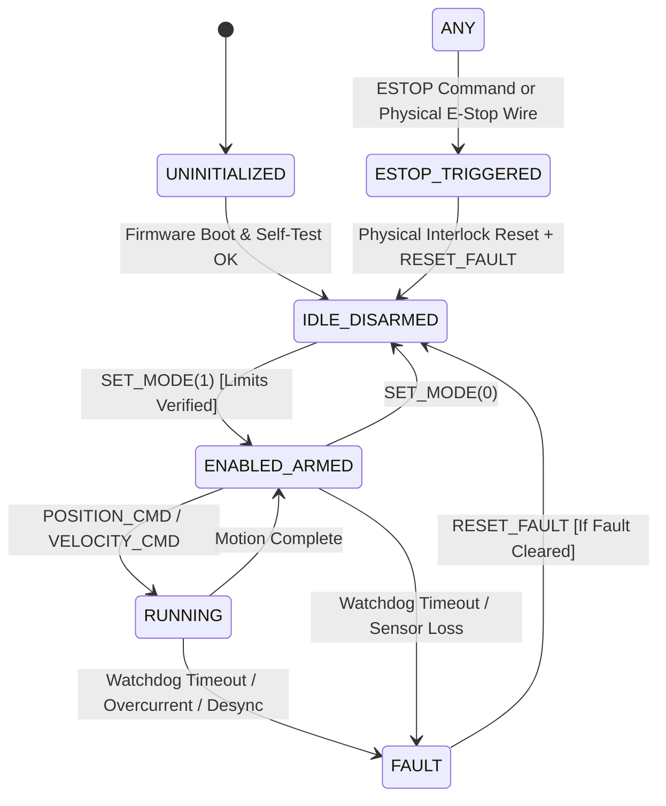

# EARS-RL Single-Axis Actuator Bench Communication Protocol Specification (V1.1)

## 1. System Context & Hardware Topology

The single-axis actuator bench establishes a deterministic, framed communication pipeline between the Host PC (Raspberry Pi 5 / Research Workstation) and an embedded motor controller:

```
[ Host PC / Python EARS-RL ]
         │
         │  USB Serial / UART (115200 - 921600 baud, 8N1)
         ▼
[ ESP32-S3 Microcontroller ]
    ├── TMC2209 Stepper Driver (STEP / DIR / UART diagnostics)
    ├── Hybrid Stepper Motor (NEMA 17/23, 200 steps/rev, 1.8°)
    └── Optical/Magnetic Encoder (ABZ / SPI / I2C, 4096 CPR)
```

---

## 2. Frame Format & Binary Encoding

Every message transmitted over the serial bus is framed with a fixed header, variable-length payload, and CRC-16-CCITT checksum. All multi-byte numeric fields are encoded in **Little-Endian** byte order.

```
+---------------+---------------+---------------+---------------+---------------+---------------+
| Magic (2B)    | Version (1B)  | Msg Type (1B) | Seq ID (2B)   | Length (2B)   | Payload (NB)  | CRC16 (2B)   |
| 0xAA 0x55     | 0x01          | uint8         | uint16        | uint16        | variable      | uint16       |
+---------------+---------------+---------------+---------------+---------------+---------------+
```

### 2.1 Header Fields

1. **Magic (`0xAA 0x55`)**: 2 bytes fixed frame synchronization marker.
2. **Version (`0x01`)**: 1 byte protocol version identifier.
3. **Message Type**: 1 byte defining the command/telemetry message.
4. **Sequence ID**: 2 bytes monotonically increasing counter ($0 - 65535$).
5. **Length**: 2 bytes indicating payload byte count $N$ (excluding header and CRC).
6. **Payload**: $N$ bytes structured data.
7. **CRC-16-CCITT**: 2 bytes polynomial $0\text{x}1021$ with initial value $0\text{xFFFF}$ computed over Header + Payload.

---

## 3. Message Types & Payload Schemas

### 3.1 Host Commands (`Host -> ESP32-S3`)

| Type Code | Name | Payload Size | Fields & Physical Units | Description |
| :--- | :--- | :--- | :--- | :--- |
| `0x01` | `PING` | 8 bytes | `host_timestamp_ns` (`uint64`, ns) | Heartbeat and clock synchronization |
| `0x03` | `SET_MODE` | 1 byte | `enable_motion` (`uint8`, 0=disarm, 1=arm) | Driver excitation enable/disable |
| `0x04` | `POSITION_CMD` | 12 bytes | `target_pos_rad` (`float32`, rad)<br>`max_vel_rad_s` (`float32`, rad/s)<br>`max_accel_rad_s2` (`float32`, rad/s²) | Kinematic trajectory setpoint |
| `0x05` | `VELOCITY_CMD` | 8 bytes | `target_vel_rad_s` (`float32`, rad/s)<br>`max_accel_rad_s2` (`float32`, rad/s²) | Continuous velocity setpoint |
| `0x08` | `ESTOP` | 0 bytes | None | Emergency stop: immediate motor de-energize |
| `0x09` | `RESET_FAULT` | 0 bytes | None | Explicit reset of latching fault state |

### 3.2 Controller Responses (`ESP32-S3 -> Host`)

| Type Code | Name | Payload Size | Fields & Physical Units | Description |
| :--- | :--- | :--- | :--- | :--- |
| `0x02` | `PONG` | 16 bytes | `host_timestamp_echo_ns` (`uint64`, ns)<br>`device_timestamp_us` (`uint64`, $\mu\text{s}$) | Round-trip latency and clock offset response |
| `0x10` | `TELEMETRY` | 24 bytes | `sequence_id_ack` (`uint16`)<br>`device_timestamp_us` (`uint64`, $\mu\text{s}$)<br>`measured_position_rad` (`float32`, rad)<br>`measured_velocity_rad_s` (`float32`, rad/s)<br>`motor_current_ma` (`uint16`, mA)<br>`device_state` (`uint8`)<br>`error_code` (`uint8`)<br>`step_loss_steps` (`int16`, counts) | Real-time sensor and actuator state feedback |
| `0x20` | `ACK` | 1 byte | `status_code` (`uint8`, 0=OK) | Command accepted |
| `0x21` | `NACK` | 1 byte | `error_code` (`uint8`) | Command rejected with specific error |

---

## 4. Device State Machine & Safety Semantics

The firmware implements a strict finite state machine (FSM):



### Safety Invariants Enforced by Protocol:
1. **Zero Motion on Boot**: The device enters `IDLE_DISARMED` with TMC2209 driver bridge in high-impedance (de-energized).
2. **Watchdog Timeout ($500\text{ ms}$)**: If no valid packet (`PING`, `POSITION_CMD`) is received within $500\text{ ms}$, the firmware transitions to `FAULT` and kills motor pulses.
3. **No Motion Replay on Reconnect**: When serial connection drops or reconnects, all pending commands in memory queues are purged. Motion can only resume after an explicit `SET_MODE(1)` arm command.
4. **Latching Faults**: `FAULT` state cannot be cleared simply by sending a new position command. An explicit `RESET_FAULT` command must be sent after the physical condition is safe.

---

## 5. Clock Synchronization & Latency Estimation Protocol

Because Host PC and ESP32-S3 operate on separate physical oscillators, **raw timestamps must never be subtracted directly across clock domains**.

### Ping-Pong Round-Trip Synchronization Protocol:
1. Host sends `PING` with host monotonic timestamp $T_1 = \text{host\_timestamp\_ns}$.
2. Controller receives at local microsecond clock $T_{\text{dev}}$ and immediately responds with `PONG` echoing $T_1$ and reporting $T_{\text{dev}}$.
3. Host receives `PONG` at $T_2 = \text{host\_timestamp\_ns}$.
4. Round-Trip Time (RTT):
   $$\tau_{\text{RTT}} = T_2 - T_1$$
5. Estimated Host Timestamp at Device Event:
   $$\hat{T}_{\text{host}} = T_1 + \frac{\tau_{\text{RTT}}}{2}$$
6. Calibrated Clock Offset:
   $$\Delta_{\text{offset}} = (T_{\text{dev}} \times 1000) - \hat{T}_{\text{host}}$$

This protocol guarantees that command-to-feedback latency is measured exclusively in the Host's clock domain, while telemetry events can be aligned with microsecond precision.

---

## 6. Streaming Frame Reassembly & Noise Rejection

Because UART transmission delivers data in arbitrary byte chunks and may encounter physical bus noise, both Host PC Python software and ESP32-S3 firmware implement an identical sliding-window state machine:

- **Python**: `ears_rl.hardware.protocol.StreamFrameParser`
- **Firmware (C)**: `stream_parser_t` in `firmware/esp32_s3/main/protocol.c`

### Parser Operational Characteristics:
1. **Magic Resynchronization**: Scans byte-by-byte for preamble `0xAA 0x55`. Discards arbitrary junk bytes prior to the magic sequence.
2. **Bounds Enforcement**: Enforces `MAX_PAYLOAD_SIZE = 256` bytes. If `payload_len` exceeds 256 or version is invalid, parser resets and resynchronizes.
3. **CRC-16-CCITT Verification**: Upon accumulating `FRAME_HEADER_SIZE + payload_len + 2` bytes, validates the checksum. Corrupt packets are dropped or NACKed with code `ERR_CRC_MISMATCH`.

---

## 7. Dual Watchdog Safety Decoupling

To prevent control loop freezing during active trajectories while tolerating lower-rate diagnostic loops:

1. **Communication Watchdog ($500\text{ ms}$)**:
   - Reset by any valid incoming frame (`PING`, `SET_MODE`, `POSITION_CMD`).
   - If no packet is received for $500\text{ ms}$, controller transitions to `FAULT` (`ERR_WATCHDOG_TIMEOUT`).
2. **Motion Trajectory Watchdog ($50\text{ ms}$)**:
   - Active only in `STATE_RUNNING`.
   - Requires continuous setpoints at $\ge 20\text{ Hz}$.
   - If motion setpoints stall for $> 50\text{ ms}$ (even if low-rate `PING` heartbeats continue), controller cuts excitation to prevent runaway inertial drift.

---

## 8. Error Codes Specification

| Code | Identifier | Description |
| :--- | :--- | :--- |
| `0` | `ERR_NONE` | No error / Normal operation |
| `1` | `ERR_CRC_MISMATCH` | Frame checksum verification failed |
| `2` | `ERR_UNKNOWN_MSG_TYPE` | Unrecognized message identifier code |
| `3` | `ERR_WATCHDOG_TIMEOUT` | Comm ($500\text{ ms}$) or Motion ($50\text{ ms}$) watchdog expired |
| `4` | `ERR_COMMAND_OUT_OF_BOUNDS` | Target position/velocity violates hard limits |
| `5` | `ERR_DRIVER_FAULT` | TMC2209 driver flag (thermal warning, short circuit) |
| `6` | `ERR_STEP_LOSS_DETECTED` | Encoder desynchronization exceeding threshold |
| `7` | `ERR_ESTOP_ACTIVE` | Emergency stop asserted (hardware or software) |
| `8` | `ERR_INVALID_SEQUENCE` | Sequence number out-of-order or duplicate |
| `9` | `ERR_COMMISSIONING_MODE` | Motion command rejected because commissioning safe mode is active |

---

## 9. Canonical Test Vectors & Cross-Language Verification

Four canonical test vectors are hardcoded in both Python (`PROTOCOL_TEST_VECTORS`) and C (`firmware/esp32_s3/test_protocol_host.c`) to ensure 100% byte-level cross-platform determinism:

1. `PING_SEQ_1`: `aa5501010100080000ca9a3b000000009e7e`
2. `SET_MODE_ARM_SEQ_2`: `aa55010302000100016d79`
3. `ESTOP_SEQ_10`: `aa5501080a000000bd9a`
4. `RESET_FAULT_SEQ_11`: `aa5501090b000100003247`

Verification commands:
- **Python**: `pytest tests/unit/test_protocol.py` (passes 100%)
- **Firmware C**: `firmware/esp32_s3/test_protocol_host.exe` (passes 5/5)

