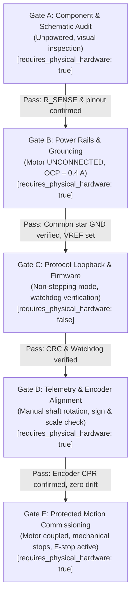

# EARS-RL Single-Axis Hardware Readiness & Commissioning Architecture (V1.3.3)

**Document Status**: Official Commissioning Specification (Pre-Flight Physical Bench)  
**Safety Status**: Physical Motion Disabled by Default (`hardware_enabled: false`)  
**Transient Protection Status**: `UNRESOLVED — HARDWARE POWER-UP BLOCKED` (Active TVS validation required)  
**Datasheet Compliance**: Locked to Trinamic / Analog Devices TMC2209 Datasheet Rev 1.09  
**Target Actuator**: Single-Axis Hybrid Stepper-Encoder Bench (NEMA 17 + TMC2209 + 4096 CPR Encoder + ESP32-S3)

---

## 1. Safety Directive & Fundamental Invariants

> [!CAUTION]
> **ABSOLUTE HARDWARE SAFETY INVARIANT**:
> Automated tests, unit tests, and CI/CD pipelines must NEVER transmit active pulse, velocity, or motion commands to physical motor drivers. All physical commissioning gates in this document must be executed interactively by a qualified engineer with physical hardware in hand and a manual hardwired E-stop switch within immediate reach.
>
> Software interlocks (such as `SafetyState.FAULT` or `ActionDecision.is_rejected = True`) are command-filtering guardrails. **THEY DO NOT CUT MOTOR POWER AND DO NOT GUARANTEE MECHANICAL STOPPING.**

---

## 2. Electrical Power Architecture & Grounding Topology

### 2.1 Power Rail Separation
The single-axis test bench utilizes two distinct electrical power domains:

1. **Logic Power Rail ($V_{\text{IO}} = 3.3\text{ V DC}$)**:
   - Source: Low-noise $3.3\text{ V}$ LDO voltage regulator on the ESP32-S3 development board (or dedicated isolated logic bench supply).
   - Loads: ESP32-S3 core, TMC2209 logic interface ($V_{\text{IO}}$ pin), optical/magnetic encoder logic ($V_{\text{CC}}$), signal level shifters.
   - Operating Range (Datasheet Rev 1.09, §20.1): $V_{\text{VIO}} \in [3.00\text{ V}, 5.25\text{ V}]$.
   - Absolute Maximum Rating (Datasheet Rev 1.09, §19): $V_{\text{VIO}} \in [-0.5\text{ V}, 5.5\text{ V}]$.
   - Typical Current: $150\text{ mA} - 350\text{ mA}$ peak (with Wi-Fi/BLE off).

2. **Motor Power Bus ($V_{\text{M}} / V_{\text{VS}} = 12\text{ V} - 24\text{ V DC}$)**:
   - Source: Regulated DC bench power supply with programmable over-current protection (OCP) and over-voltage protection (OVP).
   - Operating Range (Datasheet Rev 1.09, §20.1): $V_{\text{VS}} \in [5.5\text{ V}, 29.0\text{ V}]$ (internal +5V regulator active), or $[4.7\text{ V}, 5.4\text{ V}]$ (regulator bridged: $V_{\text{5VOUT}} = V_{\text{VS}}$).
   - Continuous Operating Recommendation: Max $29.0\text{ V DC}$.
   - Initial Commissioning Current Limit: Hardware capped at $0.4\text{ A}$ (Gate B).
   - Operational Current Limit: Capped at $1.5\text{ A} - 2.0\text{ A}$ maximum.

### 2.2 Common Star Ground Reference vs. Galvanic Isolation (Datasheet Rev 1.09, §21.2)
> [!IMPORTANT]
> **SOLID COMMON GROUND TOPOLOGY**:
> Standard StepStick carrier boards (TMC2209 breakout modules) **DO NOT provide galvanic isolation** between logic ($V_{\text{IO}}$) and motor power ($V_{\text{M}}$).
> - **Datasheet Specification (§21.2 Wiring GND)**: Trinamic mandates a solid, uninterrupted common ground plane connecting power GND, logic GND, and sense resistor GND.
> - Attempting to isolate $V_{\text{IO}}$ GND from $V_{\text{M}}$ GND without high-speed digital isolators (e.g. ADuM1401) will leave gate-drive references floating, causing destructive gate-source overvoltage ($V_{\text{GS}}$ breakdown) or severe ground bounce.
> - **High-Frequency Return Path Integrity**: Static DMM continuity check measures DC resistance ($R_{\text{GND}} \le 0.2\,\Omega$). However, **DC continuity alone is NOT proof of an adequate low-impedance high-frequency return path**. High-frequency PWM chopper switching currents ($20\text{ kHz} - 40\text{ kHz}$) flowing through shared digital ground traces can cause ground bounce of several volts that corrupts UART communication or resets the microcontroller.
> - Motor coil return currents must flow directly back to the power supply terminal via dedicated heavy-gauge wires, completely separate from signal ground traces.

### 2.3 Bulk Decoupling Capacitor Protection (Datasheet Rev 1.09, §21.3)
- **Official Specification (Trinamic TMC2209 Datasheet Rev 1.09, §21.3 Supply Filtering)**:
  Trinamic explicitly recommends:
  > *"decoupled with an electrolytic capacitor (47 µF or larger is recommended alongside ceramic surface-mount capacitors)"*
  - **Datasheet Supply Filtering Recommendation**: An electrolytic capacitor of **$47\,\mu\text{F}$ or larger** placed alongside ceramic decoupling capacitors close to the $V_{\text{S}}$ pins.
  - **Separation of Filtering Role vs. Transient-Energy Sizing**: The datasheet recommendation of $47\,\mu\text{F}$ or larger is for normal supply filtering and PWM switching-ripple suppression; it is **NOT** proof that a particular capacitance is sufficient for the application's transient energy events. Sizing for inductive kickback and regenerative energy transients is a separate, unverified engineering requirement.
  - **EARS-RL Project Engineering Choice**: We adopt a **$100\,\mu\text{F}$ (or larger, e.g. $220\,\mu\text{F}$)** low-ESR electrolytic capacitor as a deliberate engineering margin factor for enhanced ripple attenuation and energy absorption (unverified for transient fault clearance). We **NEVER** claim $100\,\mu\text{F}$ is a strict minimum mandated by datasheet §21.3, nor do we treat $47\,\mu\text{F}$ or $100\,\mu\text{F}$ as proof of transient-energy sufficiency.
- **Ceramic Decoupling Requirements (§21.3)**:
  - **$V_{\text{S}}$ Decoupling**: High-frequency ceramic surface-mount MLCC ($100\text{ nF} - 1\,\mu\text{F}$, $\ge 50\text{ V}$, X7R) placed directly across $V_{\text{S}}$ and GND adjacent to the IC pins to snub high-speed MOSFET switching ringing.
  - **5VOUT Pin Stability**: Low-ESR ceramic capacitor of **$2.2\,\mu\text{F} - 4.7\,\mu\text{F}$** connected between 5VOUT and GND for internal linear voltage regulator stability.
- **Electrolytic Capacitor Specifications**:
  - **Voltage Rating**: For a $24\text{ V}$ motor supply, the capacitor must be rated for **$\ge 35\text{ V}$ (preferably $50\text{ V}$)** to maintain dielectric margin against inductive surges and prevent accelerated aging.
  - **ESR & Ripple**: Low-ESR ($< 0.2\,\Omega$ at $100\text{ kHz}$), ripple current rating $\ge 1.0\text{ A}_{\text{RMS}}$, rated for $105^\circ\text{C}$.
- **Lead Length & Layout Clarification**:
  The engineering target of **lead length $< 15\text{ mm}$** is a **practical PCB and prototyping layout rule-of-thumb** to minimize parasitic trace loop inductance ($L \frac{di}{dt}$), rather than a literal sentence in the silicon datasheet. Keeping loop area minimal prevents transient voltage ringing during high-speed MOSFET commutation.
- **Critical Limitation**: While a $100\,\mu\text{F}$ capacitor absorbs pure coil magnetic energy ($2.0\text{ mJ}$ single-phase at $4\text{ mH}, 1\text{ A}$; $4.0\text{ mJ}$ two-phase total at $1\text{ A}$ per phase or microstepping at $I_{\text{RMS}}=1\text{ A}$; $8.0\text{ mJ}$ full-step at $1.414\text{ A}$), **a $100\,\mu\text{F}$ capacitor alone does NOT guarantee overvoltage protection from regenerative kinetic energy** ($34.125\text{ mJ} - 98\text{ mJ}$ will spike bus voltage far above $33.0\text{ V}$).

### 2.4 Inductive Back-EMF, TVS Clamping Fallacy & Regenerative Protection

> [!CAUTION]
> **OFFICIAL SILICON VOLTAGE BOUNDARIES (TMC2209 Datasheet Rev 1.09, §19 & §20.1)**:
> - Recommended Operating Voltage ($V_{\text{VS}}$): $5.5\text{ V} - 29.0\text{ V DC}$ (internal regulator) or $4.7\text{ V} - 5.4\text{ V}$ (bridged).
> - **Supply Voltage Operating with Inductive Load Max**: **$32.0\text{ V DC}$** (§19 Absolute Maximum Ratings).
> - **Supply and Bridge Voltage Max**: **$33.0\text{ V DC}$** (§19 Absolute Maximum Ratings: accounts for inductive kickbacks and voltage overshoots during normal operation).
>
> *Historical Correction Note*: Earlier documents assumed a 36.0 V continuous / 40.0 V surge limit. A direct audit of official TMC2209 Datasheet Rev 1.09 confirms there is no 36 V or 40 V rating. The actual silicon absolute maximum is 32.0 V operating with inductive load, and 33.0 V bridge max including kickbacks. Operating above 32 V / 33 V causes permanent driver failure.

#### 2.4.1 The "30V–33V TVS Diode" Clamping Fallacy
In amateur motor control setups, it is often erroneously claimed that placing a *"30V or 33V bidirectional TVS diode across $V_{\text{M}}$ and GND will clamp all flyback spikes safely below driver limits"*. **This is a dangerous electrical fallacy.**

A TVS diode has three distinct voltage ratings that must never be conflated:
1. **Reverse Stand-Off Voltage ($V_{\text{RWM}}$)**: The maximum DC working voltage at which the TVS is completely in its high-impedance OFF state (leakage current $I_{\text{D}} \le 5\,\mu\text{A}$).
2. **Breakdown Voltage ($V_{\text{BR}}$)**: The voltage where avalanche breakdown initiates, measured at a low test current (typically $I_{\text{T}} = 1\text{ mA}$).
3. **Maximum Clamping Voltage ($V_{\text{C}}$)**: The maximum voltage drop across the TVS when conducting its rated peak pulse current ($I_{\text{PP}}$).

#### Numerical Proof of Protection Failure:
Consider standard commercial TVS diodes nominally designated "30V" or "33V" (e.g. Littelfuse SMBJ series, Datasheet Rev 2021/04):
- **`SMBJ30CA`**:
  - $V_{\text{RWM}} = 30.0\text{ V}$
  - $V_{\text{BR}} = 33.30\text{ V} - 36.80\text{ V}$ (at $1\text{ mA}$)
  - **$V_{\text{C,max}} = 48.4\text{ V}$** at peak pulse current $I_{\text{PP}} = 12.4\text{ A}$ ($10/1000\,\mu\text{s}$ pulse)
- **`SMBJ33CA`**:
  - $V_{\text{RWM}} = 33.0\text{ V}$
  - $V_{\text{BR}} = 36.70\text{ V} - 40.60\text{ V}$ (at $1\text{ mA}$)
  - **$V_{\text{C,max}} = 53.3\text{ V}$** at peak pulse current $I_{\text{PP}} = 11.3\text{ A}$ ($10/1000\,\mu\text{s}$ pulse)

Both standard TVS diodes clamp transient spikes to **$48.4\text{ V}$ and $53.3\text{ V}$**, respectively. When subjected to an inductive flyback pulse from a collapsing motor phase coil, `SMBJ30CA` **exceeds the TMC2209 32.0 V inductive limit by $16.4\text{ V}$ (+51%) and the 33.0 V bridge ceiling by $15.4\text{ V}$ (+47%)**, resulting in immediate gate dielectric punch-through or MOSFET avalanche destruction!

#### The Passive TVS Dilemma on a 24V DC Bus:
- To clamp $V_{\text{C}} \le 32.0\text{ V}$ during peak inductive surge, the TVS clamping ratio ($V_{\text{C}} / V_{\text{BR}} \approx 1.35 - 1.45$) dictates that:
  $$V_{\text{BR}} \le \frac{32.0\text{ V}}{1.4} \approx 22.8\text{ V} \implies V_{\text{RWM}} \le 19.5\text{ V} - 20.5\text{ V}$$
- However, on a nominal $24.0\text{ V DC}$ power rail with typical $+5\%$ bench power supply regulation tolerance and $1\text{ V}$ ripple, the rail reaches $26.2\text{ V}$.
- A TVS with $V_{\text{RWM}} \le 20.5\text{ V}$ will **conduct continuously in its breakdown region during normal un-faulted operation**, drawing tens of amperes, overheating in seconds, and causing fire or destructive short-circuit!
- **Domain Constraint**: Within the domain of discrete passive silicon TVS diodes on a $24\text{ V}$ rail, the overlapping windows between $V_{\text{RWM}} \ge 26.2\text{ V}$ and $V_{\text{C}} \le 32.0\text{ V}$ cannot be satisfied.

#### Critical Review of `SMBJ18CA` Candidate:
- Littelfuse `SMBJ18CA` (Pinned Source Artifact: `docs/datasheets/Littelfuse_TVS_Diode_SMBJ_Datasheet.pdf`, SHA-256: `8c61bd4e70a9cd0506005cc70cd1ba5b0c8e76c8545f18cbfd19a78e16b08aa4`, Source: Digi-Key / Littelfuse Catalog Rev. 2005/04):
  $V_{\text{RWM}} = 18.0\text{ V}$, $V_{\text{BR}} = 20.00\text{ V} - 22.10\text{ V}$ (at $1\text{ mA}$), $V_{\text{C}} = 29.2\text{ V}$ at rated peak pulse current $I_{\text{PP}} = 20.6\text{ A}$ ($10/1000\,\mu\text{s}$ standard pulse), $P_{\text{PPM}} = 600\text{ W}$ minimum.
- **DO NOT label `SMBJ18CA` as an approved or safe component based merely on nominal $V_{\text{C}} = 29.2\text{ V} < 32.0\text{ V}$!**
  1. *Bus Voltage Limit (24V)*: On a $24\text{ V}$ rail ($V_{\text{max}} = 26.2\text{ V}$), $V_{\text{RWM}} = 18.0\text{ V}$ causes continuous breakdown and destructive thermal runaway (`NORMAL_CONDUCTION_RISK`).
  2. *Low-Voltage Rail ($12\text{ V} - 15\text{ V}$)*: Even on a $15\text{ V}$ rail ($V_{\text{max}} = 16.75\text{ V} < 18\text{ V}$), the catalog $V_{\text{C}} = 29.2\text{ V}$ applies strictly to a single non-repetitive $10/1000\,\mu\text{s}$ impulse.
  3. *Parasitic Inductance & Thermal Derating*: High $\frac{di}{dt}$ through PCB trace inductance ($V = L_{\text{trace}} \frac{di}{dt}$) and positive temperature coefficient (+0.1%/°C) can easily spike clamping voltage above $32.0\text{ V}$.
  4. *TVS Energy Metric Taxonomy, Provenance & Mathematical Derivation*:
     - **`DATASHEET_PEAK_PULSE_POWER`**: $P_{\text{PPM}} = 600\text{ W}$ at $10/1000\,\mu\text{s}$ (Datasheet Page 1, Maximum Ratings Table, Note 1 & Note 2). This is an instantaneous peak power rating at pulse crest ($t = t_{\text{peak}}$), NOT an energy absorption capability.
     - **Standard Waveform Provenance & Documented Editions**:
       * Datasheet Fig. 3 explicitly cites: *"10/1000µsec. Waveform as defined by R.E.A"* (U.S. Rural Electrification Administration Bulletin 345-65 / PE-60).
       * Telecommunication Standard: Telcordia GR-1089-CORE, Issue 4 (June 2006) / Issue 6 (May 2011), Section 4 defines 10/1000 µs lightning surges.
       * Component Standard: IEEE C62.35-2010 (Standard Test Methods for Avalanche Junction Semiconductor Surge-Protective Device Components), Section 4.3.
       * Distinction: IEC 61000-4-5 specifies combination waves ($1.2/50\,\mu\text{s}$ / $8/20\,\mu\text{s}$) and telecom waves ($10/700\,\mu\text{s}$); it does NOT define $10/1000\,\mu\text{s}$.
     - **`MATHEMATICAL_PULSE_ENERGY_ESTIMATE`**: The theoretical time integral of a normalized double-exponential instantaneous power waveform $p(t) = A (e^{-t/\tau_1} - e^{-t/\tau_2})$:
       With standard impulse parameters ($\tau_1 \approx 1426.18\,\mu\text{s}, \tau_2 \approx 1.4496\,\mu\text{s}$, peak time $t_{\text{peak}} \approx 10.0000\,\mu\text{s}$, peak power $P_{\text{PPM}} = 600.0\text{ W}$):
       $$t_{\text{peak}} = \frac{\tau_1 \tau_2}{\tau_1 - \tau_2} \ln\left(\frac{\tau_1}{\tau_2}\right) = 1.0000035 \times 10^{-5}\text{ s} \approx 10.0000\,\mu\text{s}$$
       $$\text{norm} = e^{-t_{\text{peak}}/\tau_1} - e^{-t_{\text{peak}}/\tau_2} = 0.99200344 \approx \mathbf{0.9920}$$
       $$A = \frac{P_{\text{PPM}}}{\text{norm}} = \frac{600.0\text{ W}}{0.99200344} = 604.83661\text{ W} \approx \mathbf{604.84\text{ W}}$$
       $$E_{\text{double\_exp}} = A (\tau_1 - \tau_2) = 604.83661\text{ W} \times 1.4247304 \times 10^{-3}\text{ s} = 0.861729\text{ J} \approx \mathbf{0.8617\text{ J}}$$
       *(Audit Verification: Mathematical consistency between $\text{norm} \approx 0.9920$, $A \approx 604.84\text{ W}$, and $E \approx 0.8617\text{ J}$ is proven exact.)*
       *Instantaneous Power Model & Clamping Assumptions*: This integral models instantaneous power $p(t)$. If interpreted as electrical power $p(t) = v_{\text{clamp}}(t) \cdot i(t)$, it assumes that clamping voltage is approximately constant ($V_{\text{C}}$) or lumped into the composite power curve. Real semiconductor dynamics (dynamic resistance $R_{\text{dyn}}$ and junction temperature heating) are not modeled. This integral is strictly an idealized mathematical property of the test waveform, NOT measured physical energy and NOT datasheet-certified absorption capability.
       *Correction of Fallacies*: The naive heuristic $P_{\text{PPM}} \times t_d = 600\text{ W} \times 1\text{ ms} = 0.6\text{ J}$ is a rectangular pulse fallacy. Furthermore, the factor $(1/\ln 2) P_{\text{PPM}} t_d$ applies strictly to a single pure exponential decay without front rise time; it is NOT a general double-exponential relationship.
     - **`APPLICATION_PULSE_ENERGY_CAPACITY`**: Strictly **`UNDETERMINED`**.
       This mathematical integral ($0.8617\text{ J}$) does **NOT** prove hardware absorption capacity for real-world stepper back-EMF dumping. Hypothetical unverified mechanical deceleration transient durations (e.g. an assumed $10\text{ ms} - 100\text{ ms}$ window for an unbraked spinning axis; this is an assumed scenario, NOT an empirically measured or mathematically modeled duration for this robot bench) subject the TVS to prolonged dissipation far beyond standard test impulses.
       *Datasheet Thermal Condition & Figure 1 Audit*:
       1. **Figure 1 Range Limit**: Fig. 1 (*Peak Pulse Power Rating*, Page 3, log-log plot at $T_A = 25^\circ\text{C}$ mounted on $5.0 \times 5.0\text{ mm}$ ($0.2 \times 0.2''$) copper pad to each terminal) covers pulse durations from $0.1\,\mu\text{s}$ up to $10\text{ ms}$ only. At $t_d = 10\text{ ms}$, allowable peak pulse power is $\sim 180\text{ W}$ (approximate visual graph reading). Ratings at $100\text{ ms}$ are **`UNAVAILABLE`** (the horizontal axis terminates at $10\text{ ms}$; no data or curve is provided for $100\text{ ms}$).
       2. **Steady-State Rating Condition ($5.0\text{ W}$)**: The $5.0\text{ W}$ power dissipation rating in full SMBJ specifications is defined strictly under an **infinite heat sink condition at lead temperature $T_L = 50^\circ\text{C}$** ($R_{\theta JL} \approx 20^\circ\text{C/W}$), representing a **CONDITIONAL RATING — NOT DIRECTLY APPLICABLE TO A TYPICAL PCB WITHOUT THERMAL VALIDATION**. Under typical conditions on a PCB with $5.0 \times 5.0\text{ mm}$ copper pad to each terminal in still air, typical thermal resistance $R_{\theta JA} \approx 100^\circ\text{C/W}$ provides an estimated dissipation limit of $(150 - 25)/100 \approx 1.25\text{ W}$ (this $1.25\text{ W}$ figure is a thermal estimate dependent on mounting geometry and ambient conditions, not a universal guaranteed continuous-power rating).
       3. **No Curve Convergence**: The transient peak pulse derating curve reflects non-repetitive short-duration heat capacity of the silicon die; it must **not** be assumed to converge to the continuous infinite-heat-sink rating.
       Without application-specific current/voltage profiles and manufacturer transient thermal impedance curves ($Z_{\theta JA}(t)$), application energy capacity cannot be determined.
- **Hardware Status**: Strictly **`EVALUATED_CANDIDATE — UNVERIFIED`** (`HARDWARE POWER-UP BLOCKED`).

> [!WARNING]
> **COMMISSIONING SAFETY GATE STATUS**:
> **`UNRESOLVED — HARDWARE POWER-UP BLOCKED`**
> No unverified passive TVS part number shall be connected or assumed safe on a $24\text{ V}$ rail. Physical power-up of the test bench at $24\text{ V}$ remains strictly blocked until a validated protection architecture is qualified.

#### 2.4.2 Comprehensive Multi-Pathway Energy Accounting & 98 mJ Reconciliation

When the motor power supply is abruptly interrupted or disconnected under load, energy from multiple pathways must be accounted for:

$$\Delta E_{\text{net}} = E_{\text{mag}} + E_{\text{kin}} + E_{\text{supply}} + E_{\text{residual}} - E_{\text{dissipated}}$$

##### The Five Energy Accounting Cases:
| Case | Description | Energy Components | Typical Energy | Voltage on $80\,\mu\text{F}$ | Safety Status |
| :--- | :--- | :--- | :--- | :--- | :--- |
| **Case 1** | Pure Magnetic Energy Only (Stationary $\omega = 0$) | $E_{L,1\text{-phase}} = \frac{1}{2} L I^2$ $E_{\text{mag,2-phase}} = \sum_{k=1}^2 \frac{1}{2} L I_k^2$, $E_{\text{kin}} = 0$ | $2.0\text{ mJ}$ (1-phase, $4\text{ mH}, 1\text{ A}$) $4.0\text{ mJ}$ (2-phase total, $1\text{ A}$/phase or microstep $I_{\text{RMS}}=1\text{ A}$) $8.0\text{ mJ}$ (full-step, $1.414\text{ A}$/phase) | $25.02\text{ V}$ (1-phase) $26.00\text{ V}$ (2-phase) $27.86\text{ V}$ (full-step) | **WITHIN_OPERATIONAL_LIMITS** ($< 29.0\text{ V}$) |
| **Case 2** | Magnetic + Kinetic Energy (Rotating $\omega > 0$) | $E_{\text{mag}} + \frac{1}{2} J_{\text{total}} \omega^2$ | $34.125\text{ mJ}$ (1-phase $2\text{ mJ} + 32.125\text{ mJ}$) $36.125\text{ mJ}$ (2-phase $4\text{ mJ} + 32.125\text{ mJ}$) $98.0\text{ mJ}$ (high-speed) | $37.80\text{ V}$ (1-phase) $38.46\text{ V}$ (2-phase) $55.01\text{ V}$ (high-speed) | **DESTRUCTIVE_BRIDGE_OVERVOLTAGE** ($> 33.0\text{ V}$) |
| **Case 3** | Continuous Power Supply Injection (Disconnect Latency) | $E_{\text{mag}} + E_{\text{kin}} + \int_0^{t_{\text{fault}}} V_{\text{source}}(t) I_{\text{source}}(t) dt$ | $V_{\text{bus}}=24\text{ V}, I_{\text{ps}}=1.0\text{ A}^*$ $t_{\text{detect}}=1.0\text{ ms}^*, t_{\text{contactor}}=5.0\text{ ms}^*$ $E_{\text{supply}} = 144.0\text{ mJ}$ $E_{\text{net}} = 180.125\text{ mJ}$ (2-phase) or $178.125\text{ mJ}$ (1-phase) | $\mathbf{71.27\text{ V}}^{**}$ (2-phase) $\mathbf{70.92\text{ V}}^{**}$ (1-phase) | **DESTRUCTIVE_BRIDGE_OVERVOLTAGE** ($> 33.0\text{ V}$) |
| **Case 4** | Dissipative Pathways Accounted For | $E_{\text{net}} = E_{\text{total}} - E_{\text{copper}} - E_{\text{friction}}$ | $E_{\text{net}} < E_{\text{ideal}}$ | Attenuated | **Dependent on net energy** |
| **Case 5** | Indeterminate / Missing Parameters | Unknown $C_{\text{bulk}}$, $J$, $\omega$, or $I_{\text{ps}}/t_{\text{fault}}$ | Undefined | Undefined | **INDETERMINATE_MISSING_PARAMETERS** (Power-up blocked) |

*\* Note on Parameters*: $I_{\text{ps}} = 1.0\text{ A}$ is an assumed upper bound based on the bench power supply current limit (NOT a measured physical current). Timing delays are classified strictly as `[ASSUMED — NOT MEASURED]` engineering scenario parameters, NOT verified physical hardware timings. In addition, mechanical contactor opening delay ($t_{\text{contactor}} = 5.0\text{ ms}$, electromechanical drop-out) and solid-state electronic switch-off delay ($t_{\text{switch\_off}} = 5.0 - 10.0\,\mu\text{s}$, gate discharge) are kept explicitly distinct in parameters and analysis.  
*\*\* Note on $71.27\text{ V}$ (2-phase) / $70.92\text{ V}$ (1-phase)*: These are strictly `IDEALIZED_UPPER_BOUND_SCENARIO` (lossless ceiling) values, valid ONLY when 100% of modeled energy is dumped into an initial $80\,\mu\text{F}$ capacitor at $24.0\text{ V}$ with zero resistive losses, zero load dissipation, and zero active voltage clamping.

> [!IMPORTANT]
> **Parameter Completeness Requirement for Case 3**:
> In accordance with safety invariant rules, if Case 3 is evaluated without explicit values for power supply current ($I_{\text{ps}}$) or fault duration ($t_{\text{fault}} = t_{\text{detect}} + \max(t_{\text{contactor}}, t_{\text{switch\_off}})$), `compute_energy_accounting()` strictly returns `CASE_5_INDETERMINATE_MISSING_PARAMETERS` with `is_safe=False`. Unparameterized energy injection shall never be presumed safe or negligible.

##### High-Side Electronic Disconnect Reality (Architecture 3):
- A solid-state electronic switch does **NOT** eliminate power supply energy if detection latency ($t_{\text{detect}}$) or switch-off time ($t_{\text{switch\_off}}$) is non-zero.
- During the finite interval $t_{\text{disconnect}} = t_{\text{detect}} + t_{\text{switch\_off}} > 0$, the power supply continues injecting energy:
  $$E_{\text{supply}} = \int_0^{t_{\text{disconnect}}} V_{\text{source}}(t) I_{\text{source}}(t)\,dt > 0$$
- In addition, any residual charge stored on downstream decoupling capacitors ($E_{\text{residual}} = \frac{1}{2} C_{\text{out}} V^2$) remains on the driver bus. Therefore, claiming $E_{\text{supply}} = 0$ for high-side disconnect without zero latency is scientifically invalid.

##### Origin and Physical Reconciliation of Phase Energy & the 98 mJ Benchmark:
- **Phase-Energy Scope & Reconciliation ($E_L = \frac{1}{2} L I^2$)**:
  - **One Phase ($L = 4.0\text{ mH}, I = 1.0\text{ A}$)**: $E_{L,1\text{-phase}} = 0.5 \times (0.004\text{ H}) \times (1.0\text{ A})^2 = \mathbf{2.0\text{ mJ}}$.
  - **Two Identical Energized Phases ($L = 4.0\text{ mH}, I = 1.0\text{ A}$ per phase)**: $E_{L,2\text{-phase}} = 2 \times 2.0\text{ mJ} = \mathbf{4.0\text{ mJ}}$.
  - **Sinusoidal Microstepping ($L = 4.0\text{ mH}, I_{\text{RMS}} = 1.0\text{ A} \implies I_{\text{peak}} = \sqrt{2}\text{ A} \approx 1.414\text{ A}$)**: Total energy across both quadrature phases is $E_{\text{mag,total}} = \frac{1}{2} L (i_A^2 + i_B^2) = \frac{1}{2} L I_{\text{peak}}^2 = \mathbf{4.0\text{ mJ}}$ (or $8.0\text{ mJ}$ in two-phase-on full-step at $1.414\text{ A}$).
  - **Audit of "4.41 mJ per phase" Claim**: The figure `4.41 mJ per phase` is unsupported by the project's baseline parameters ($L = 4.0\text{ mH}, I = 1.0\text{ A}$). Mathematically, $4.41\text{ mJ}$ would require unconfigured inputs (e.g. $L = 4.0\text{ mH}, I \approx 1.4849\text{ A}$ or $L = 2.0\text{ mH}, I = 2.1\text{ A}$). It is formally classified as **`UNDETERMINED`**.
- **Baseline NEMA 17 Parameters**:
  - Phase Inductance & Current: $L = 4.0\text{ mH}$, $I_{\text{RMS}} = 1.0\text{ A}$ ($I_{\text{peak}} = 1.414\text{ A}$) $\implies E_{\text{mag}} = 4.0\text{ mJ}$ (two-phase total; single-phase at $1.0\text{ A}$ is $2.0\text{ mJ}$).
  - Inertia: $J_{\text{rotor}} = 5.7 \times 10^{-6}\text{ kg}\cdot\text{m}^2$, $J_{\text{load}} = 20.0 \times 10^{-6}\text{ kg}\cdot\text{m}^2$ ($J_{\text{total}} = 25.7 \times 10^{-6}\text{ kg}\cdot\text{m}^2$).
  - Baseline Shaft Speed: $\omega = 50.0\text{ rad/s}$ ($\approx 477.5\text{ RPM}$).
  - Kinetic Energy: $E_{\text{kin}} = 0.5 \times (25.7 \times 10^{-6}) \times (50)^2 = 32.125\text{ mJ}$.
  - **Baseline Total Energy**: $E_{\text{total}} = 4.0 + 32.125 = \mathbf{36.125\text{ mJ}}$ (two-phase total), $\mathbf{34.125\text{ mJ}}$ (single-phase $2.0\text{ mJ} + 32.125\text{ mJ}$), or $\mathbf{40.125\text{ mJ}}$ (full-step at $1.414\text{ A}$).
  - Bus Voltage Rise on $C_{\text{eff}} = 80\,\mu\text{F}$ ($100\,\mu\text{F} - 20\%$ tolerance):
    $$V_{\text{final,2-phase}} = \sqrt{24^2 + \frac{2 \times 0.036125}{80 \times 10^{-6}}} = \sqrt{576 + 903.125} = \sqrt{1479.125} = \mathbf{38.46\text{ V}} > 33.0\text{ V}$$
    $$V_{\text{final,1-phase}} = \sqrt{24^2 + \frac{2 \times 0.034125}{80 \times 10^{-6}}} = \sqrt{576 + 853.125} = \sqrt{1429.125} = \mathbf{37.80\text{ V}} > 33.0\text{ V}$$
    Both the two-phase ($36.125\text{ mJ}$) and single-phase ($34.125\text{ mJ}$) baselines exceed the $33.0\text{ V}$ TMC2209 absolute maximum bridge rating!
- **Reconciling the 98.0 mJ Figure**:
  - The previously reported $98.0\text{ mJ}$ produces $V_{\text{final}} = \sqrt{576 + 2450} = \sqrt{3026} = \mathbf{55.01\text{ V}}$ on $80\,\mu\text{F}$.
  - To reach $98.0\text{ mJ}$ physically ($4\text{ mJ}$ magnetic $+ 94\text{ mJ}$ kinetic), the motor must operate at:
    $$\omega = \sqrt{\frac{2 \times 0.094}{25.7 \times 10^{-6}}} \approx 85.53\text{ rad/s} \quad (\approx 816.7\text{ RPM})$$
    or couple a heavier load inertia $J_{\text{load}} \approx 69.5 \times 10^{-6}\text{ kg}\cdot\text{m}^2$.

#### 2.4.2.1 Voltage Calculation Taxonomy & Mandatory Declared Assumptions
To prevent scientific ambiguity or ungrounded claims, all capacitor voltage rise calculations:
$$V_{\text{final}} = \sqrt{V_{\text{initial}}^2 + \frac{2 \Delta E_{\text{net}}}{C_{\text{eff}}}}$$
are strictly classified into a three-tiered taxonomy:
1. **`IDEALIZED_UPPER_BOUND_SCENARIO`** (Default): A theoretical lossless upper bound representing the worst-case ceiling. It is **NOT** a measured physical prediction or guaranteed actual voltage.
2. **`MODEL_BASED_ESTIMATE`**: A dynamic differential equation (ODE) simulation accounting for motor phase resistance ($I^2 R$), freewheeling diode forward voltage drop ($2 V_{\text{D}}$), mechanical viscous friction, and magnetic core iron losses.
3. **`MEASURED_PHYSICAL_VOLTAGE`**: An empirical measurement obtained from calibrated, high-bandwidth oscilloscope probes connected directly across driver VM and GND during physical bench tests.

**Mandatory Declared Assumptions (Idealized Upper Bound)**:
Whenever presenting an `IDEALIZED_UPPER_BOUND_SCENARIO`, the calculation strictly declares:
1. *100% Energy Transfer*: 100% of kinetic and magnetic energy is converted into the electrical domain without mechanical friction, air drag, or iron core losses.
2. *Lossless Conduction*: Negligible phase copper resistance ($I^2 R$) and body-diode forward drop dissipation during the entire transient event.
3. *Unidirectional Supply / Zero Sinking*: Zero power supply sinking capability (purely uni-directional supply; the power supply disconnects or blocks reverse current via an ideal diode).
4. *Constant Capacitance*: Constant effective capacitance ($C_{\text{eff}}$) without DC voltage bias derating, temperature degradation, or dielectric leakage.
5. *Non-Zero Latency Conduction*: High-side disconnect does not eliminate supply energy if detection or switch-off latency is non-zero ($t_{\text{fault}} > 0$).

#### 2.4.3 Multi-Architecture Transient Protection Evaluation
Because discrete passive TVS diodes cannot reliably clamp between $26.2\text{ V}$ and $32.0\text{ V}$ on a $24\text{ V}$ bus, and because active brake choppers face pulse overload hazards, EARS-RL systematically evaluates four alternative protection architectures before commissioning:

1. **Architecture 1 — Supply Voltage Derating to $12\text{ V} - 15\text{ V DC}$**:
   - Operating the bench on a $12\text{ V} - 15\text{ V}$ supply substantially expands voltage headroom below the $32.0\text{ V} / 33.0\text{ V}$ limit.
   - Status: **`EVALUATED_CANDIDATE — UNVERIFIED`** (Hardware power-up remains BLOCKED until surge current margins, thermal derating, and PCB trace parasitic inductance $L \frac{di}{dt}$ are verified on bench).
2. **Architecture 2 — Active Brake Chopper ($28.5\text{ V}$ Clamp, $5\,\Omega / 25\text{ W}$)**:
   - Dynamic electronic circuit: Fast comparator ($< 1\,\mu\text{s}$), N-channel MOSFET, and power dump resistor ($5\,\Omega, 25\text{ W}$).
   - *Audit Status*: Strictly **`CONCEPTUAL_DESIGN — UNVERIFIED`**.
   - *Resistor Continuous Wattage Fallacy*: Peak instantaneous power is $P_{\text{peak}} = \frac{(28.5\text{ V})^2}{5.0\,\Omega} = 162.45\text{ W}$, which is $6.5\times$ the $25\text{ W}$ nominal continuous rating! Continuous wattage rating specifies free-air thermal equilibrium; it does not prove pulse survival.
   - *Resistor Pulse Energy Rating*: The previously cited $E_{\text{pulse}} \ge 2.0\text{ J}$ is an arbitrary heuristic safety factor (~55x over 36 mJ baseline). Without target dumped energy, deceleration profile, and duty cycle data, required pulse energy capacity is strictly **`UNDETERMINED`**.
   - *Gate Drive Failure Hazard*: Loss of +5V/+3.3V logic supply during an E-stop drops gate drive to 0V, disabling the chopper while the motor continues regenerating.
3. **Architecture 3 — High-Side Electronic Disconnect with Reverse Blocking Diode**:
   - Fast solid-state disconnect switch (P-FET or Back-to-Back N-FETs) combined with a series Schottky or ideal diode controller.
   - *Reality*: Does NOT yield $E_{\text{supply}} = 0$ during finite detection and switch-off delays ($t_{\text{detect}} + t_{\text{switch\_off}} > 0$). Traps regenerative energy on the driver side, requiring local capacitance or secondary clamp.
4. **Architecture 4 — Independent Mechanical Power-Off Holding Brake**:
   - Spring-engaged, power-off electromagnetic brake attached directly to the motor shaft.
   - *Mandatory for Vertical Axes*: Directly prevents mechanical back-driving and gravitational free fall when electrical power is severed.

> [!WARNING]
> **COMMISSIONING SAFETY GATE STATUS**:
> **`UNRESOLVED — HARDWARE POWER-UP BLOCKED`**
> The active brake chopper is not the sole solution, and no unverified protection architecture shall be assumed safe. Physical power-up of the test bench remains strictly blocked until one of the qualified architectures is bench-tested and approved with oscilloscope evidence.

#### 2.4.4 Freewheeling Body Diode Bridge Rectification During E-Stop
- **The Body Diode Trap**:
  When a software or hardware E-stop pulls TMC2209 `ENABLE` HIGH, driver gate drive shuts off and MOSFET channels open.
  However, if the motor shaft is rotating with mechanical load inertia, the motor acts as an AC generator producing back-EMF ($V_{\text{BEMF}} = K_e \omega$).
  The internal MOSFET **parasitic body diodes form an uncontrolled full-wave bridge rectifier** connected directly between phase windings and $V_{\text{M}}$/GND!
- **Consequence**: Whenever generated back-EMF exceeds $V_{\text{M}} + 2 V_D$, these body diodes conduct current directly into the disconnected DC bus bulk capacitor, pumping bus voltage upwards regardless of `ENABLE` state!
- **Conclusion**: Pulling `ENABLE` HIGH does **NOT** eliminate kinetic overvoltage unless the rotor is held stationary or an active chopper absorbs the energy.

#### 2.4.5 Mechanical Consequences of Power Cut & Holding Torque Loss
- **Horizontal Direct-Drive Axes**:
  When $V_{\text{M}}$ is cut, holding torque drops to detent torque ($\approx 5\% - 10\%$ of rated holding torque). System friction and detent torque decelerate the shaft to rest without hazardous acceleration.
- **Vertical / Gravity-Loaded Axes (Back-Driving Hazard)**:
  > [!CAUTION]
  > For any axis supporting a vertical load or non-backdrivable counterweight, **cutting $V_{\text{M}}$ or deasserting `ENABLE` completely eliminates holding torque**. The gravitational load will accelerate downwards in free fall, back-driving the motor and generating high-voltage back-EMF!
  > A vertical test axis **MUST** incorporate a spring-engaged, power-off electromagnetic holding brake or non-backdrivable lead screw before any E-stop test.

---

## 3. TMC2209 Motor Current & VREF Calculation (Datasheet Rev 1.09)

### 3.1 Standalone Analog Scaling Mode
In standalone mode, motor coil current is set via an analog reference voltage $V_{\text{REF}}$ applied to the driver VREF pin from an on-board trimmer potentiometer.

#### Formulas:
$$\boxed{I_{\text{RMS}} = \left[\frac{0.325\text{ V}}{R_{\text{SENSE}} + 0.020\,\Omega}\right] \times \left[\frac{1}{\sqrt{2}}\right] \times \left[\frac{V_{\text{REF}}}{2.5\text{ V}}\right]}$$

Inverting to solve for target reference voltage $V_{\text{REF}}$:

$$\boxed{V_{\text{REF}} = I_{\text{RMS}} \times \sqrt{2} \times (R_{\text{SENSE}} + 0.020\,\Omega) \times \left(\frac{2.5\text{ V}}{0.325\text{ V}}\right)}$$

Where:
- $V_{\text{FS}} = 0.325\text{ V}$: Internal full-scale current sensing reference voltage.
- $R_{\text{BRD}} \approx 0.020\,\Omega$: Typical PCB layout and MOSFET trace parasitic resistance.
- $R_{\text{SENSE}}$: Physical surface-mount sense resistor value on the breakout module.
- $V_{\text{REF}}$: Voltage measured between VREF test pad and driver GND ($0.0\text{ V} \le V_{\text{REF}} \le 2.5\text{ V}$).

#### Sense Resistor Inspection Table:
| SMD Marking | Resistance $R_{\text{SENSE}}$ | $R_{\text{TOTAL}} = R_{\text{SENSE}} + 0.020\,\Omega$ | Multiplier $V_{\text{REF}} / I_{\text{RMS}}$ | Example: $V_{\text{REF}}$ for $0.80\text{ A}_{\text{RMS}}$ |
|---|---|---|---|---|
| `R110` | $0.110\,\Omega$ | $0.130\,\Omega$ | $\approx 1.4142$ | **$1.131\text{ V}$** |
| `R075` | $0.075\,\Omega$ | $0.095\,\Omega$ | $\approx 1.0335$ | **$0.827\text{ V}$** |
| `R220` | $0.220\,\Omega$ | $0.240\,\Omega$ | $\approx 2.6109$ | **$2.089\text{ V}$** |

### 3.2 Distinction Across Operating Modes
1. **Standalone Mode (Potentiometer Analog VREF)**: Applies the equations above. VREF pin must receive $0.0\text{ V} - 2.5\text{ V}$.
2. **UART Digital Register Mode (`IHOLD_IRUN`)**: Current is scaled by 5-bit register values:
   $$I_{\text{RMS}} = \frac{\text{IRUN} + 1}{32} \times \frac{V_{\text{FS}}}{(R_{\text{SENSE}} + 0.020\,\Omega) \sqrt{2}}$$
   In pure UART mode, analog VREF scaling can be disabled in the `GCONF` register.
3. **Internal RDSon Sensing Mode (`internal_Rsense = 1`)**: Replaces external resistors with MOSFET conduction resistance ($\approx 0.17\,\Omega$). The formulas above do NOT apply; current varies strongly with junction temperature.

### 3.3 Engineering Deratings & Silicon Limits
- **Heuristic Thermal Deratings**:
  - Continuous Holding (Natural Convection): $I_{\text{target}} \approx 0.70 \times I_{\text{rated}}$.
  - Intermittent / Forced Air Cooling: $I_{\text{target}} \approx 0.85 \times I_{\text{rated}}$.
  - *Engineering Note*: These multipliers are empirical heuristics to keep motor casing below $70^\circ\text{C}$; they are NOT universal physical safety laws.
- **TMC2209 Silicon Limits**:
  - Continuous RMS current ceiling without forced airflow: $1.4\text{ A}_{\text{RMS}}$.
  - Absolute peak transient current: $2.0\text{ A}_{\text{PEAK}}$.
  - Thermal pre-warning flag (`otpw`): $120^\circ\text{C}$.
  - Thermal shutdown threshold (`ot`): $150^\circ\text{C}$.

---

## 4. Multi-Tier Safety Boundary Semantics

Safety states operate across distinct software, firmware, electrical, and mechanical layers:

| Layer | State Name | Implementation Mechanism | Physical Actuator Reality |
|---|---|---|---|
| **Software** | `COMMAND_BLOCKED` | `ActionShield.shield() -> None` | New commands dropped. Motor power and pulse generation may still be active! |
| **Firmware** | `STEP_PULSES_SUPPRESSED` | MCU hardware timer stopped | No new step pulses dispatched. Motor coils remain energized with holding torque! |
| **Driver** | `DRIVER_DEASSERTED` | TMC2209 `ENABLE` pin set HIGH | Driver bridge freewheels. Motor holding torque drops to zero (detent torque only). |
| **Electrical** | `POWER_DISCONNECTED` | Physical NC E-Stop switch opened | Motor bus $V_{\text{M}} = 0\text{ V}$. Driver unpowered. Power supply disconnected. |
| **Mechanical** | `MECHANICAL_REST` | Shaft angular velocity $\omega = 0$ | Actuator stationary. Verified ONLY by encoder feedback, NOT software flags! |

> [!WARNING]
> Software transitioning to `SafetyState.FAULT` indicates that the software layer has blocked new motion commands. It does NOT prove that driver power is cut or that mechanical momentum has ceased.

---

## 5. Five-Gate Progressive Commissioning Protocol (Configurable & Pre-Flight Gated)

All thresholds in this commissioning sequence are parameterized via `CommissioningGateConfig` (`src/ears_rl/application/commissioning.py`) and can be overridden in bench configuration files without editing source code.

### Gate A: Component, Datasheet, Module & Schematic Inspection
- **Hardware Requirement**: `requires_physical_hardware: true`
- **Preconditions**:
  1. Test bench unpowered.
  2. High-magnification optical inspection tool available.
- **Inspection & Measurement Method**: Visual/microscopic inspection of driver breakout markings, SMD sense resistor codes, schematic pinouts, and motor datasheet parameters.
- **Acceptance Criteria**:
  - TMC2209 IC genuine marking confirmed.
  - Optical verification of SMD sense resistors ($R_{\text{SENSE}} \in \{0.110\,\Omega, 0.075\,\Omega, 0.220\,\Omega\}$).
  - Pinout mapping verified against carrier PCB (`STEP`, `DIR`, `EN`, `PDN_UART`, `DIAG`).
  - Motor rated phase current ($I_{\text{rated}}$), phase resistance ($R_{\text{coil}}$), and inductance ($L_{\text{coil}}$) documented.
- **Abort Criteria**: Unidentifiable IC, missing heatsink, unreadable SMD sense markings, or pinout mismatch.
- **Recorded Evidence**: High-resolution component photographs and signed schematic inspection record.

### Gate B: Power Rails, Common Ground & Transient Protection (Motor UNCONNECTED)
- **Hardware Requirement**: `requires_physical_hardware: true` (Requires physical laboratory multimeter, oscilloscope, and bench power supply; software mock execution does NOT sign off physical Gate B).
- **Preconditions**:
  1. Motor phase leads physically disconnected.
  2. Bench DC supply current limit capped at initial threshold ($I_{\text{OCP}} \le 0.4\text{ A}$).
  3. Power supply turned OFF and all decoupling capacitors verified fully discharged ($0.0\text{ V}$).
- **Inspection & Measurement Method**: Calibrated DMM 4-wire resistance check, oscilloscope rail probing, E-stop circuit actuation, insulated ceramic trimmer adjustment.
- **Acceptance Criteria**:
  - **Unpowered DC Bus Non-Short Check**: Resistance between motor power rail and driver ground $R(V_{\text{M}}, \text{GND}) > 10.0\text{ k}\Omega$ (`unpowered_vm_to_gnd_min_resistance_kohm`, legacy alias `isolation_resistance_min_kohm`) measured with DC bench supply disconnected and bulk capacitors discharged. *Clarification: This is a pre-power non-short safety check, NOT a test of galvanic isolation, as the StepStick driver shares a common star ground.*
  - **Low-Impedance Common Star Ground**: $R(\text{ESP32 GND}, \text{Driver GND}) \le 0.2\,\Omega$ (`ground_continuity_max_ohm`). *Engineering Note: Static DC resistance $\le 0.2\,\Omega$ confirms physical star wiring, but does NOT prove low impedance at high PWM chopper switching frequencies ($20\text{ kHz} - 40\text{ kHz}$). High-frequency AC return integrity requires wide, direct, low-inductance return conductors.*
  - **Bulk Decoupling Capacitor**: $C_{\text{bulk}} \ge 100\,\mu\text{F}$ (`bulk_capacitor_min_uf`, rated $\ge 35\text{ V}$ or $50\text{ V}$) verified directly across driver socket $V_{\text{M}}$ and GND with correct electrolytic polarity and lead length $< 15\text{ mm}$.
  - **Transient Overvoltage Protection**: Validated overvoltage protection circuit installed and verified to guarantee $V_{\text{VS}} \le 32.0\text{ V}$ (inductive operating absolute maximum) and $V_{\text{VMAX}} \le 33.0\text{ V}$ (bridge maximum) under peak coil inductive flyback ($E = \frac{1}{2} L I_{\text{peak}}^2$). If unverified, Gate B is blocked (`UNRESOLVED — HARDWARE POWER-UP BLOCKED`).
  - **Unloaded Quiescent Current**: Initial power-on unloaded quiescent current $I_{\text{quiescent}} \le 0.05\text{ A}$ (`max_unloaded_quiescent_current_a`).
  - **Physical Hardwired E-Stop**: Actuating the physical E-stop switch drops $V_{\text{M}}$ to $0.0\text{ V}$ immediately.
  - **Analog VREF Calibration**: Analog $V_{\text{REF}}$ trimmed within $\pm 0.02\text{ V}$ (`vref_tolerance_v`) of calculated target using an insulated ceramic adjustment tool.
- **Abort Criteria**: Quiescent current $> 0.05\text{ A}$; floating ground reference; failure of E-stop to cut $V_{\text{M}}$; inability to adjust stable $V_{\text{REF}}$; **unverified TVS or transient protection (`UNRESOLVED — HARDWARE POWER-UP BLOCKED`)**; any attempt to sign off physical Gate B using mock simulation data without physical laboratory measurements.
- **Recorded Evidence**: DMM resistance calibration log, VREF adjustment record, and E-stop cut-off oscilloscope capture signed by commissioning engineer.

### Gate C: Firmware & Serial Communication Protocol (Non-Stepping Mock Mode)
- **Hardware Requirement**: `requires_physical_hardware: false` (Executes identically in mock simulation or over USB-serial).
- **Preconditions**:
  1. ESP32-S3 flashed with Protocol V1.
  2. Driver `ENABLE` held HIGH (disabled) and `hardware_enabled: false`.
- **Inspection & Measurement Method**: Automated CRC-16 loopback, host heartbeat ping/pong handshake, watchdog timeout verification, and commissioning motion injection.
- **Acceptance Criteria**:
  - Telemetry packet loss $\le 0.10\%$ (`packet_loss_max_percent`); CRC-16 error rate $\le 0.010\%$ (`crc_error_max_percent`) over $> 1000$ consecutive frames.
  - Host heartbeat watchdog trips and asserts software `FAULT` within $\le 500.0\text{ ms}$ (`watchdog_trip_max_ms`).
  - **Motion Rejection Invariant**: Motion commands (`POSITION_CMD`) transmitted during commissioning mode are strictly rejected with error code `ERR_COMMISSIONING_MODE (9)`.
- **Abort Criteria**: CRC failure rate $> 0.01\%$, heartbeat watchdog failing to trip within $500\text{ ms}$, or spontaneous pulses observed on oscilloscope.
- **Recorded Evidence**: JSON commissioning diagnostic report (`reports/hardware/commissioning_report.json`).

### Gate D: Telemetry, Timestamps & Encoder Validation (Manual Shaft Rotation)
- **Hardware Requirement**: `requires_physical_hardware: true`
- **Preconditions**:
  1. Motor unpowered or driver disabled.
  2. Telemetry streaming active.
- **Inspection & Measurement Method**: Manual $360^\circ$ clockwise shaft rotation with high-precision optical/magnetic encoder streaming.
- **Acceptance Criteria**:
  - Sequence IDs increment strictly monotonic ($+1$) without drops.
  - Timestamps strictly monotonic ($\Delta t > 0$) with jitter $\le 2.0\text{ ms}$ (`timestamp_jitter_max_ms`).
  - Manual clockwise turn of $360^\circ$ produces positive displacement ($+\Delta\theta > 0$) matching configured CPR (e.g. $+4096\text{ counts} = +2\pi\text{ rad}$, `encoder_cpr`).
  - Standstill noise floor: stationary shaft peak-to-peak position noise $\le 0.005\text{ rad}$ (`standstill_noise_max_rad`).
- **Abort Criteria**: Inverted rotation polarity, missing encoder pulses, non-monotonic timestamps, sequence gaps, or standstill noise $> 0.01\text{ rad}$.
- **Recorded Evidence**: Raw telemetry stream log (`.jsonl` or `.csv`) and encoder sign verification record.

### Gate E: Protected Single-Axis Motion Commissioning (Strictly Gated, Pre-Flight Only)
- **Hardware Requirement**: `requires_physical_hardware: true`
- **Preconditions**:
  1. Gates A through D formally signed off.
  2. Hard mechanical travel limits ($\pm 180^\circ$) fitted with polyurethane bumpers.
  3. Operator hand on physical hardwired E-stop switch.
  4. Bench DC supply current limit set to $0.4\text{ A}$ (`initial_ocp_limit_a`).
- **Inspection & Measurement Method**: Commanded low-speed crawl trapezoidal motion profile passed through ActionShield.
- **Acceptance Criteria**:
  - Motor phase current derated to $70\%$ (`thermal_derating_factor`) of rated continuous current.
  - Crawl command ($\pm 0.20\text{ rad}$ at $0.50\text{ rad/s}$, `motion_crawl_position_rad`, `motion_crawl_velocity_rad_s`) executes smoothly without acoustic resonance.
  - Encoder feedback tracks commanded trajectory within $\pm 0.10\text{ rad}$.
- **Abort Criteria**: Tracking error exceeding $0.10\text{ rad}$, thermal runaway ($> 70^\circ\text{C}$ motor casing), audible grinding, or limit switch contact.
- **Recorded Evidence**: Synchronous command vs encoder telemetry log and thermal temperature log.
