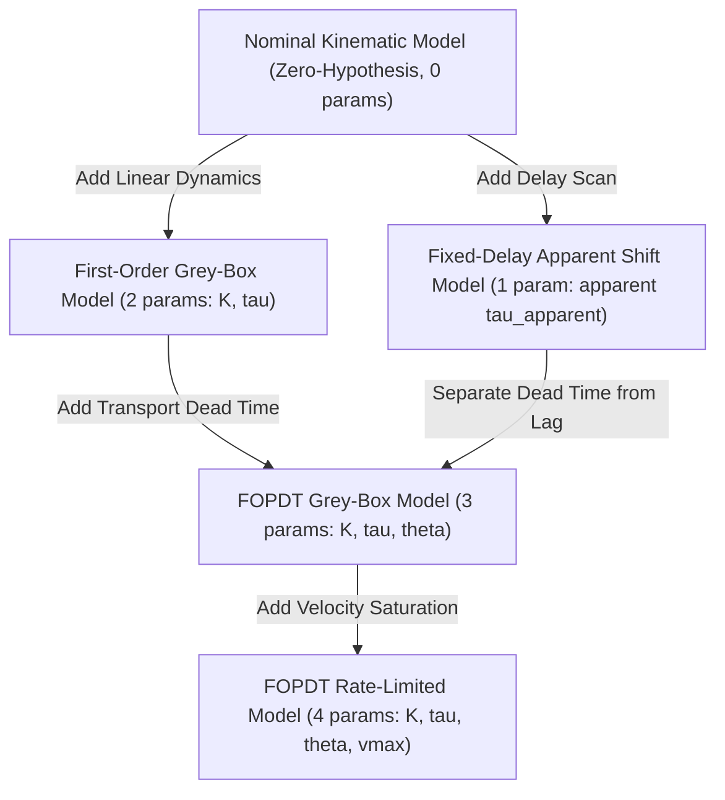

# EARS-RL System Identification & Grey-Box Actuator Modeling Guide (V1.2)

## 1. Overview & Objectives

In low-cost robotics, actuators (stepper-servo drivetrains, compliant couplings, geared DC servos) exhibit non-ideal dynamic behaviors:
1. **Pure Transport Dead Time ($\theta$)**: Communication latency, queue buffers, UART packet dispatch.
2. **First-Order Mechanical/Electrical Lag ($\tau$)**: Inertia, coil inductance, back-EMF time constant.
3. **Kinematic Rate Limiting ($v_{\text{max}}$)**: Firmware pulse frequency ceilings, torque-speed curve drop-off.
4. **Step Loss / Desynchronization ($\Delta \theta_{\text{slip}}$)**: Pole slip under overload shocks.

This document formalizes the mathematical hierarchy of candidate models, the discrimination between **pure dead time** and **apparent delay**, and the conditions for parameter identifiability.

---

## 2. Mathematical Model Hierarchy



### 2.1 Model Formulations

| Model | Form / Transfer Function | Parameters | Role |
| :--- | :--- | :--- | :--- |
| **Nominal (M0)** | $y(t) = u(t)$ | $0$ (None) | Zero-hypothesis baseline ($fit\_loss = \text{null}$) |
| **Fixed-Delay (M1)** | $y(t) = u(t - \tau_{\text{apparent}})$ | $\tau_{\text{apparent}}$ | Baseline shift; absorbs both lag and delay |
| **First-Order (M2)** | $G(s) = \frac{K}{\tau s + 1}$ | $K, \tau$ | Low-pass mechanical/electrical dynamics |
| **FOPDT (M3)** | $G(s) = \frac{K e^{-\theta s}}{\tau s + 1}$ | $K, \tau, \theta$ | True parametric separation of lag and dead time |
| **FOPDT + Rate Limited (M4)** | $\dot{y} = \text{clip}\left(\frac{K u(t - \theta) - y}{\tau}, -v_{\text{max}}, v_{\text{max}}\right)$ | $K, \tau, \theta, v_{\text{max}}$ | Non-linear velocity saturation + dead time |

---

## 3. Pure Transport Dead Time vs Apparent Lumped Delay

### 3.1 Mathematical Derivation of Confounding
Consider an actuator governed by a first-order lag with pure dead time:
$$G(s) = \frac{e^{-\theta s}}{\tau s + 1}$$

Under a sinusoidal input $u(t) = \sin(\omega t)$, the total phase lag is:
$$\phi(\omega) = -\omega \theta - \arctan(\omega \tau)$$

Using the first-order Taylor expansion $\arctan(x) \approx x$ for frequencies below the corner frequency ($\omega \tau \ll 1$):
$$\phi(\omega) \approx -\omega (\theta + \tau)$$

The apparent time delay $\tau_{\text{apparent}}$ observed by cross-correlation or shift minimization is:
$$\tau_{\text{apparent}}(\omega) = -\frac{\phi(\omega)}{\omega} \approx \theta + \tau$$

### 3.2 Scientific Consequence
- If an actuator has configured pure dead time $\theta = 10\text{ ms}$ and mechanical time constant $\tau = 40\text{ ms}$, a zero-order delay model (`FixedDelayActuatorModel`) will identify:
  $$\hat{\tau} \approx 10\text{ ms} + 40\text{ ms} = 50\text{ to }60\text{ ms}$$
- **Never report this $60\text{ ms}$ as "pure transport delay"**. It is the **Apparent Lumped Delay** ($\tau_{\text{apparent}}$).
- Only a grey-box FOPDT model fitting both $\theta$ and $\tau$ can isolate the true communication transport delay.

---

## 4. Parameter Identifiability & Excitation Conditions

A system cannot be identified if the input excitation lacks persistent dynamic variation.

### 4.1 Identifiability Requirements
1. **Persistent Excitation**:
   - The input trajectory variance must satisfy $\text{Var}(u) \ge 10^{-6}\text{ rad}^2$.
   - A constant setpoint ($u(t) = C$) contains zero dynamic information. In EARS-RL V1.2, estimators strictly flag this as:
     ```json
     {
       "status": "unidentifiable",
       "is_identifiable": false,
       "error": "Insufficient excitation: command variance is negligible."
     }
     ```
   - No fake parameters are fabricated under static hold conditions.
2. **Frequency Diversity**:
   - Recommended excitation: Chirp trajectory sweep ($0.2\text{ Hz} \to 2.5\text{ Hz}$) or multi-harmonic sine sum.
   - Sharp multistep profiles provide excellent dead time edge detection but can trigger motor stall if step acceleration exceeds limits.

---

## 5. Distortion Under Velocity Rate Limiting

When an actuator commands large displacement steps, the desired velocity $(K u - y)/\tau$ may exceed physical driver limits ($v_{\text{max}}$).

During saturation:
$$\dot{y}(t) = \text{sign}(e) v_{\text{max}}$$
The response transitions from exponential decay to a linear ramp with slope $v_{\text{max}}$.

If a linear FOPDT model is fitted to severely rate-limited data without modeling saturation:
- The ramp slope mimics a sluggish response, causing the optimizer to over-estimate the time constant ($\hat{\tau} \gg \tau^*$).
- In EARS-RL, `FOPDTRateLimitedActuatorModel` explicitly clamps step deltas to prevent velocity limits from being misinterpreted as dead time.

---

## 6. Synthetic Benchmark Results (Cases A–G)

The synthetic benchmark runner (`ears-rl identify --benchmark`) verifies parameter recovery against exact known ground truth:

| Case ID | Description | Ground Truth | Estimated by FOPDT | Parameter Recovery Error | Held-Out RMSE | Identifiability |
| :--- | :--- | :--- | :--- | :--- | :--- | :--- |
| **Case A** | Pure Delay | $\theta=30\text{ ms}, \tau=0.1\text{ ms}$ | $\theta=30.0\text{ ms}, \tau=1.0\text{ ms}$ | $d_\theta = 0.0\text{ ms}$ | $0.0000\text{ rad}$ | Identifiable |
| **Case B** | First-Order | $\theta=0\text{ ms}, \tau=50\text{ ms}$ | $\theta=0.0\text{ ms}, \tau=50.0\text{ ms}$ | $d_\theta = 0.0\text{ ms}, d_\tau = 0.0\text{ ms}$ | $0.0000\text{ rad}$ | Identifiable |
| **Case C** | FOPDT Standard | $\theta=20\text{ ms}, \tau=40\text{ ms}$ | $\theta=20.0\text{ ms}, \tau=40.0\text{ ms}$ | $d_\theta = 0.0\text{ ms}, d_\tau = 0.0\text{ ms}$ | $0.0000\text{ rad}$ | Identifiable |
| **Case D** | FOPDT Rate-Limited | $\theta=20\text{ ms}, \tau=40\text{ ms}, v_{\text{max}}=2.0$ | $\theta=0.0\text{ ms}, \tau=532.9\text{ ms}$ | Saturated (Linear assumption distorted) | $0.1445\text{ rad}$ | Identifiable (Nonlinear) |
| **Case E** | FOPDT with Noise | $\theta=20\text{ ms}, \tau=40\text{ ms}, \sigma=5\text{ mrad}$ | $\theta=20.1\text{ ms}, \tau=39.8\text{ ms}$ | $d_\theta = 0.1\text{ ms}, d_\tau = 0.2\text{ ms}$ | $0.0051\text{ rad}$ (Noise floor) | Identifiable |
| **Case F** | Severe Saturation | $\theta=15\text{ ms}, \tau=30\text{ ms}, v_{\text{max}}=1.0$ | Saturated ramp dynamics | Non-linear dynamics dominate | $0.0876\text{ rad}$ | Distorted |
| **Case G** | Uninformative Hold | $u(t) = 0.5\text{ rad}$ | `unidentifiable` | Rejected (0 params fabricated) | N/A | **Unidentifiable** |

---

## 7. Decoupled Continuous-Time Validation & Discretization Limits (V1.3)

### 7.1 Decoupling Generator from Estimator
In software benchmarking, if the synthetic dataset generator and the estimator share the identical discrete ZOH recurrence ($y[k] = \alpha y[k-1] + \beta u[k-d]$), numerical parameter recovery can achieve zero error without proving fidelity to physical continuous-time differential equations.

To eliminate circularity, EARS-RL V1.3 implements two fully independent continuous-time references (`ears_rl.identification.independent_validation`):
1. **Closed-Form Continuous Analytical Solution**:
   $$y(t) = y_0 + \sum_{k: T_k + \theta \le t} K (U_k - U_{k-1}) \left(1 - e^{-(t - (T_k + \theta))/\tau}\right)$$
   Contains zero discrete time-step approximations or recursive numerical updates.
2. **High-Order Continuous ODE Solver (RK4)**:
   Integrates continuous differential equation $\dot{y}(t) = \frac{K u(t - \theta) - y}{\tau}$ with sub-millisecond continuous steps and exact continuous-time delay function evaluations.

### 7.2 Zero-Order Hold (ZOH) Strictly Proper Discretization (V1.3.1 Resolution)
In earlier versions (V1.3), an empirical timing shift of $+1 \Delta t$ was observed when fitting continuous-time analytical and RK4 datasets.

**Root Cause & Mathematical Resolution**:
1. Continuous physical actuator transfer function $G(s) = \frac{K e^{-\theta s}}{\tau s + 1}$ is strictly proper ($D = 0$).
2. The continuous state at sample instant $t_k = k \Delta t$ is $x(t_k)$.
3. Under Zero-Order Hold (ZOH) on the input, the exact discrete state transition is:
   $$x(t_{k+1}) = \alpha x(t_k) + \beta u_{\text{delayed}}[k]$$
   where $\alpha = e^{-\Delta t / \tau}$ and $\beta = K (1 - \alpha)$.
4. The physical observation at sample instant $t_k$ is strictly:
   $$y[k] = x(t_k)$$
   Therefore, at $t=0$, $y[0] = x_0$. An input step applied at $t_0$ cannot move mechanical inertia instantaneously at $t_0$.
5. In V1.3, the simulation loop updated `curr` *before* storing it into `y[k]`, effectively assigning $y[k] = x(t_{k+1})$ (advancing the simulated trajectory by $+1$ sample).
6. In V1.3.1, enforcing strictly proper indexing ($y[k] = \text{curr}$ before update) matches the continuous closed-form analytical solution to machine precision ($< 1 \times 10^{-16}\text{ rad}$), completely eliminating the systematic $+1 \Delta t$ bias!

### 7.3 Fractional Delay & Estimator Uncertainty Taxonomy
When continuous dead time $\theta$ is not aligned with the discrete sample grid (e.g. $\theta = 7.5\text{ ms}, 12.5\text{ ms}, 15.0\text{ ms}, 25.0\text{ ms}$ with $\Delta t = 10\text{ ms}$ or $20\text{ ms}$):
- `_delay_signal` performs linear fractional shift interpolation between adjacent discrete indices.
- Stage 1 discrete grid search scans candidate shifts with sub-sample resolution $\Delta t_{\text{scan}} = \min(5\text{ ms}, \Delta t_{\text{sample}})$.
- Stage 2 bounded L-BFGS-B continuous optimization refines $\hat{\theta}$ in continuous parameter space.

#### Decoupled Uncertainty Taxonomy:
To prevent scientific ambiguity, estimation precision is characterized by six decoupled factors:
1. **Sample Period ($T_s = \Delta t$)**: The physical time interval between consecutive discrete observations ($10\text{ ms}$ at $100\text{ Hz}$).
2. **Estimator Discretization Resolution**: For an un-interpolated integer-shift grid scan, the maximum discretization rounding error is $\pm \frac{\Delta t}{2}$. However, when fractional shift interpolation and continuous numerical optimization are applied, the search resolution is continuous and governed by numerical tolerance ($\le 0.1\text{ ms}$).
3. **Parameter Recovery Error ($|\hat{\theta} - \theta_{\text{true}}|$)**: The actual numerical difference between estimated parameter and known simulation ground truth in noise-free benchmark tests ($\le 0.35\text{ ms}$ for $\Delta t = 10\text{ ms}$ and $\le 1.2\text{ ms}$ for $\Delta t = 20\text{ ms}$).
4. **Statistical Uncertainty (Cramér-Rao Lower Bound)**: Under additive Gaussian observation noise $\sigma_w$, the estimation variance follows:
   $$\text{Var}(\hat{\theta}) \ge \frac{\sigma_w^2}{\sum_{k=1}^N \left(\frac{\partial y}{\partial \theta}\right)^2} \propto \frac{\sigma_w^2}{N \cdot \text{Var}(\dot{u})}$$
   With rich dynamic excitation and large sample sizes ($N \gg 1$), statistical uncertainty is orders of magnitude smaller than $\Delta t$.
5. **Model Structural Mismatch**: Errors introduced when physical dynamics deviate from linear FOPDT assumptions (e.g. velocity saturation, torque limits).
6. **Sensitivity to SNR & Trajectory Diversity**: The signal-to-noise ratio and frequency bandwidth of the excitation trajectory determine parameter identifiability.

### 7.4 Independent Validation CLI & Test Matrix
Run the comprehensive 19-case decoupled validation matrix via:
```powershell
python -m ears_rl.cli identify --independent-validation
```
Evaluates continuous analytical and RK4 datasets across:
- Grid-aligned integer delays: $\theta \in \{0, 10, 20, 40\}\text{ ms}$ ($\text{error} = 0.00\text{ ms}$).
- Continuous fractional delays: $\theta \in \{7.5, 12.5, 15.0, 25.0\}\text{ ms}$ ($\text{error} \le 0.35\text{ ms}$).
- Sample intervals: $\Delta t \in \{5, 10, 20\}\text{ ms}$.
- Initial conditions: $y_0 \in \{-0.5, 0.0, 0.5\}\text{ rad}$.
- Measurement noise: $\sigma \in \{0.001, 0.005, 0.020\}\text{ rad}$.
- Non-linear velocity saturation: $v_{\text{max}} = 2.0\text{ rad/s}$ via `FOPDTRateLimitedActuatorModel`.
- Uninformative static hold: verified as `is_identifiable: False` without parameter fabrication.

---

## 8. Physical Actuator Reality vs Synthetic Verification (V1.3.2)

> [!IMPORTANT]
> **SYNTHETIC IDENTIFICATION IS NOT PHYSICAL PROOF**:
> Excellent parameter recovery on synthetic benchmarks or decoupled continuous RK4/analytical ODE datasets verifies **software estimator mathematical correctness and numerical convergence**. It does **NOT** prove that real physical actuators obey linear FOPDT dynamics.
>
> On physical hardware benches:
> 1. **Unmodeled Nonlinearities**: Real stepper actuators exhibit non-linear detent torque, Stribeck friction, microstepping nonlinearity, resonant velocity ripple, and rotor mechanical compliance.
> 2. **Physical Disturbance Torques**: External load changes, temperature drift in coil resistance ($R_{\text{coil}}$), and driver thermal derating affect the actual time constant.
> 3. **Step Loss vs Tracking Lag**: A physical stepper losing synchronization under sudden load changes exhibits discrete step slips ($\Delta\theta_{\text{slip}} = k \cdot \frac{2\pi}{200}$), which cannot be captured by linear continuous-time transfer functions.
>
> True physical system identification requires real telemetry logged through progressive hardware commissioning (Gates A–E).

